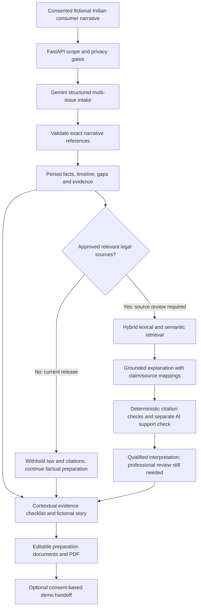

# NyaySaathi 2.0

**An India-first AI-assisted consumer case-preparation platform.** NyaySaathi helps a person turn an unfamiliar dispute into organised facts, evidence questions, editable documents and a consent-based handoff to a demonstration lawyer account.

**Current release:** a working **fictional-data demonstration**, not a production legal-advice or filing service. Gemini intake, persistent preparation, document/PDF generation and demo handoff have been exercised. **Approved authentic legal passages: 0.** Source-grounded legal conclusions and statutory citations remain withheld until provenance, version and reuse reviews are complete. The full legal-intelligence Definition of Done is not yet met.

## Why we are building it

The project grew from experiences of people struggling to know where to begin: a threatening scam call, a family member relying on someone else to understand a legal process, or an online buyer unsure what to preserve after receiving an empty box. Fear, unfamiliar language and disorganised information can make asking for help harder.

The broader vision includes accessible legal support across situations and jurisdictions. The implemented prototype starts with a narrower, testable scope: **Indian consumer disputes** involving goods, refunds, warranties, subscriptions, disputed advertising and purchased services. Bullying, domestic violence, criminal accusations and foreign-law questions are outside this initial scope; a compassionate intake does not make the system qualified to analyse every legal problem.

## What works today

| Capability | Current behaviour and boundary |
|---|---|
| Consented guest workspace | Persistent private sessions, case ownership, separate AI/sharing consent, correction, withdrawal and deletion. Guest sessions are not a claim of complete anonymity. |
| Gemini intake | English/Hindi responses, personalised follow-up questions, structured parties/amounts and a review of multiple consumer issue families when provider access and consent are available. |
| Facts and timeline | Narrative segment IDs preserve exact factual provenance; missing facts remain questions. Allegations and document excerpts are not treated as proven facts. |
| Evidence assistance | Contextual suggestions, local PDF/TXT extraction, bounded PNG/JPEG OCR when Tesseract is installed, and limited discrepancy/relevance checks. Extraction does not authenticate a document. |
| Story mode | Sixteen original bilingual fictional scenario cards. These are learning aids, not judgments, predictions or an exemption from professional obligations. |
| Readiness | Qualitative completeness findings. Readiness is not case strength or a probability of winning; missing legal-source coverage remains visible. |
| Documents and case packet | Six editable preparation templates, individual exports and a downloadable PDF packet. Drafts are not officially filed complaints or bail applications. |
| Demo lawyer handoff | Explicit sharing of a packet snapshot, a separate demonstration recipient, receipt acknowledgment and revocation. No verified advocate, matching marketplace or live consultation is claimed. |
| Legal retrieval infrastructure | Existing FTS5/embedding retrieval, source/quote checks and a separately prompted AI support check. **Authentic-law integration remains blocked by the empty approved corpus.** |

The 306 legacy records remain quarantined under `synthetic_demo/`; they are never used as authentic precedent or outcome statistics. UK case-law retrieval and unapproved ingestion remain disabled. The application does not contain thousands of verified judgments, an outcome predictor, a trained bias detector, blockchain, federated learning or court integration.

## How the solution works



The application retrieves material at request time; it has **not been fine-tuned on legal judgments**. Semantic embeddings are a search representation, not proof of legal understanding. Exact quotations can establish traceability, not substantive applicability. The same Gemini service providing a separate support check is not an independent legal expert.

The implementation preserves the existing purple/cream UI and navigation: vanilla HTML/CSS/JavaScript → one FastAPI backend → Pydantic models → SQLite/FTS5, with optional Gemini embeddings and local Tesseract OCR. It does not require a React rebuild, Postgres migration, microservices or autonomous agents. [Detailed explanation and example](docs/SOLUTION_EXPLAINED.md).

## Run locally

Use the project folder containing `main.py` and `requirements.lock`. The backend does not automatically load `.env`.

- **Windows/PyCharm:** [step-by-step PowerShell and native PDF setup](docs/WINDOWS_PYCHARM.md).
- **macOS/Safari:** run `Run_NyaySaathi_Mac.command`; [setup, credential limits and native-test status](docs/MAC_SAFARI.md).
- **Linux:** Python 3.11+; tested with Python 3.12. PDF export requires Pango/Harfbuzz and Unicode fonts. Debian/Ubuntu packages include `libpango-1.0-0`, `libpangoft2-1.0-0`, `libharfbuzz0b`, `fonts-dejavu-core`, `fonts-noto-core`. OCR additionally needs native Tesseract and optionally its Hindi language pack.

From the project root on Linux:

```bash
python -m venv .venv
.venv/bin/python -m pip install --require-hashes -r requirements.lock
mkdir -p runtime/cache
export XDG_CACHE_HOME="$PWD/runtime/cache"
.venv/bin/python -m scripts.seed_demo
.venv/bin/python -m scripts.run_demo --port 8011
```

Wait for `Uvicorn running on http://127.0.0.1:8011`, then visit that address **on the machine running the server**. A cloud machine's loopback address is not reachable directly from your laptop. Cloud browser/preview controls were unavailable in the recorded handoff; no public URL is promised. Keep the server terminal open. `python main.py` also starts the integrated app on port 8011, but the demo runner additionally reads the private seeded demonstration-recipient password.

Do not serve the whole repository with a static HTTP server. The application deliberately serves only its frontend assets and access-controlled routes; `.env`, runtime files and the database are not public assets.

## Backend configuration

See [.env.example](.env.example) for names, not secret values. Export settings in the server process or configure the IDE/service environment. Credentials configured in the cloud do not automatically transfer to a local computer.

| Variable | Purpose |
|---|---|
| `GEMINI_API_KEY` | Backend-only provider credential; never put it in frontend files or chat. |
| `GEMINI_MODEL` / `GEMINI_EMBEDDING_MODEL` | Choose models after actual account checks. Startup probes report selection and failures; a listed model alone is not proof of generation access. |
| `GEMINI_TERMS_REVIEWED` | Operator acknowledgement of provider terms/pricing/quota; does not replace per-case AI consent or establish real-confidential-data readiness. |
| `GEMINI_VERIFY_ON_START` | Defaults to true; uses synthetic connectivity probes and reports outcomes in `/api/health`. |
| `DEMO_LAWYER_PASSWORD` | Private demonstration-account password. The demo runner can instead read the seeded private file. |
| `NYAYSAATHI_RUNTIME` | Private database, evidence and local operational files; ignored by Git. |
| `COOKIE_SECURE` | Enable behind properly configured HTTPS; the local demonstration uses loopback HTTP. |
| `SESSION_TTL_HOURS` / `RETENTION_DAYS` | Bounded session/case retention; see deployment notes for cleanup and backups. |

Previously exercised generation: `gemini-3.1-flash-lite`; embeddings: configured `gemini-embedding-2` and previously tested `gemini-embedding-001`. The saved `gemini-2.5-flash` rejected generation for the tested account, so startup visibly selected a successfully probed fallback without rewriting saved variables. Availability, terms and quotas must be checked for each deployment. [Recorded live results](docs/GEMINI_LIVE_VALIDATION.md).

## Data, API and privacy controls

Additive database migrations in [backend/schema.sql](backend/schema.sql) store sessions, redacted narratives, case state, evidence BLOBs, audit records, handoff snapshots, download grants, FTS entries and optional cached vectors. Cases survive page reloads; guest access depends on the session cookie and cannot be recovered after it is lost or expires.

Core routes include `POST /api/cases/intake`, case messages/assessment/context/consent, evidence upload, editable drafts, protected PDF export, share/revoke, deletion, source lookup and a separate demonstration-recipient inbox. `/docs` lists the full API. Mutations require same-origin checks and matching CSRF tokens; case and recipient routes enforce ownership/role access. [Security and operational boundaries](docs/DEPLOYMENT.md).

The implementation has consent records, access controls, private file permissions, bounded uploads, local OCR and retention/deletion controls. **It does not provide end-to-end encryption, encrypted SQLite by default, blockchain audit logs, professional-confidentiality guarantees or certified regulatory compliance.** TLS, disk/backup encryption, provider contracts and stronger real-user authentication require deployment work. Sensitive-input screening is imperfect. Use fictional identities, narratives and documents; real-user processing remains gated.

## Adding authentic legal material later

The uploaded project presentation is a vision/reference document, **not an approved legal source**. Neither project PDFs nor invalid HTML disguised as a PDF may populate the legal corpus.

The [offline workflow](docs/OFFLINE_INGESTION.md) stages a candidate privately, leaves all reviews pending, validates without indexing, and admits only explicitly approved passages after recorded provenance, effective-version and reuse review. Required permission scope covers retention, local search, external embeddings, LLM context and quoted exports. Atomic batch admission feeds the existing provider without rebuilding RAG; it does not grant rights or certify legal accuracy. No permission or authenticity is inferred from a government-looking link. [Source/rights evidence and blockers](docs/LEGAL_SOURCE_MANIFEST.md).

## Evaluation and current limitations

Latest recorded full automated suite: **140 passed in the Linux environment**. That is not a native Windows/macOS test claim or a substantive legal-accuracy result.

| Evaluation | Strict triage checks | Exact expected label sets |
|---|---:|---:|
| Fresh 30-case first exposure | 26/30 | 17/30 |
| Final replay of the same cohort | 28/30 | 22/30 |

The replay is not a second unseen score. Unsupported extra labels and provider timeouts remain visible. A strict pass checks expected coverage and predeclared negative controls, not correctness of every added label. No win probability or legal-correctness percentage follows from these figures. [Raw results and method](docs/LEGAL_INTELLIGENCE_CONTINUATION.md).

```bash
.venv/bin/python -m pytest -q
NYAY_TEST_URL=http://127.0.0.1:8011 node tests/browser.cjs
NYAY_TEST_URL=http://127.0.0.1:8011 node tests/generalized-browser.cjs
# Strict authentic-source gate: currently blocked with zero approved passages.
NYAY_TEST_URL=http://127.0.0.1:8011 node tests/generalized-browser.cjs --require-grounded
```

Browser checks use the project's Playwright/Chromium setup and freshly created fictional cases. Native OCR needs Tesseract. Positive source-admission/hybrid tests use explicitly synthetic fixtures in temporary roots; these are not real-law validation. [Actual test reports](docs/TEST_REPORT.md).

## Next milestones

1. Obtain authentic consumer-law/rules/guidance artifacts; review provenance, commencement/amendments and reuse rights; validate grounded outputs with qualified independent legal review.
2. Improve multi-label precision and test new disputes without benchmark-specific answers; preserve abstention, evidence provenance and honest provider-failure handling.
3. Complete privacy/security/provider assessments before real-user operation, including robust accounts, encryption/backup controls and abuse protection.
4. Explore actual advocate onboarding, accessible voice intake and additional jurisdictions only with verified capabilities, permissions and jurisdiction-specific evaluation.

Court filing, outcome forecasting, trained social-bias analysis, federated learning, emotion inference, a legal digital twin and global coverage remain proposed work or research ideas. They are not completed integrations or guarantees of future performance.

## Presentation and references

- [Detailed solution, architecture and tradeoffs](docs/SOLUTION_EXPLAINED.md).
- [Presentation script for 23 November 2026, India time](docs/PRESENTATION_SCRIPT.md).
- [Slide-by-slide corrections, claim review and source notes](docs/PRESENTATION_NOTES.md).
- [Rehearsal/demo procedure](docs/DEMO_SCRIPT.md), [feature matrix](docs/FEATURE_MATRIX.md), [repository audit](docs/REPO_AUDIT.md), [implementation log](docs/IMPLEMENTATION_LOG.md).
- [User-supplied YouTube link](https://youtu.be/5yU9Otp08-U). The request was blocked in this environment; its title, transcript, content and demo claims have not been verified here.

The supplied ten-page `NyaaySaathi.pdf` names Kushagra Goel, Zaid Yusuf, Rohin Vashishth and Sujal Gupta as presenters. No individual implementation roles are inferred. The deck's market figures and court-backlog statistic lack dated citations in the supplied material and are not repeated as verified facts.
