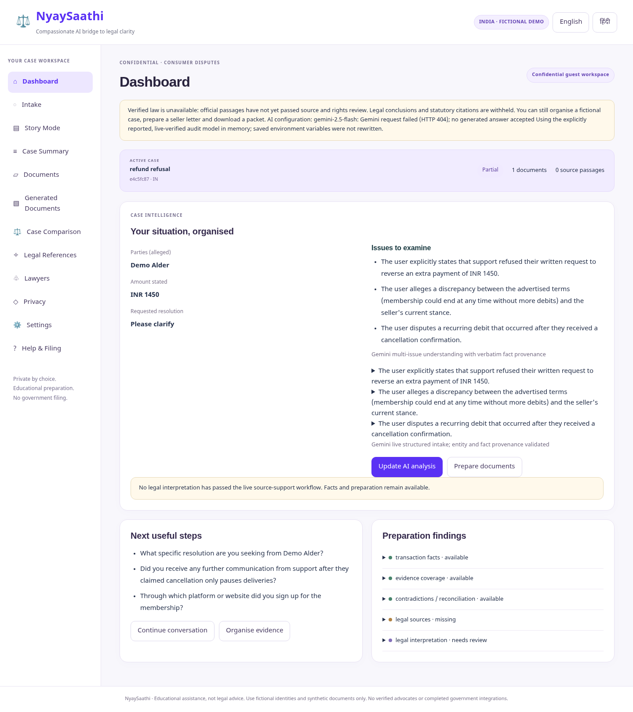
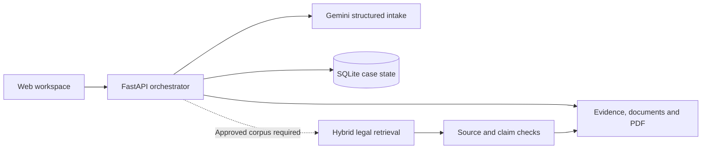

# NyaySaathi 2.0

**Organise a consumer dispute. Prepare for the next step.**

NyaySaathi is an India-first, AI-assisted case-preparation platform. It brings English/Hindi intake, facts and timelines, evidence organisation, editable documents and a downloadable case packet into one workspace.

[Try the demo](#try-the-demo) · [Run locally](#run-locally) · [Architecture](#architecture) · [Project status](#project-status) · [Documentation](#documentation)

> **Prototype status:** The preparation workflow is available for fictional-data demonstrations. Verified legal analysis is gated: **no authentic legal passages have been approved yet**. Use fictional identities and documents; real confidential-data processing remains disabled.

## Overview

When a purchase goes wrong, receipts, messages and delivery records are often scattered. NyaySaathi helps users explain what happened, identify missing information and prepare a record for seeking human help.

The initial scope is **Indian consumer disputes**: defective goods, refunds, warranties, subscriptions, advertising and services. Criminal, family and foreign-law analysis are outside this prototype.

## Features

| Feature | What the user can do |
|---|---|
| **Guided intake** | Describe a fictional dispute in English or Hindi and receive contextual Gemini follow-up questions when live AI is configured and consented. |
| **Case workspace** | Save and correct the narrative, review multiple possible issues, and keep facts, dates and unresolved questions together. |
| **Evidence organisation** | Upload supported PDF/TXT documents and images, inspect extracted information, and review case-specific evidence suggestions. Image OCR requires Tesseract. |
| **Story mode** | Explore one of 16 original bilingual fictional scenarios, clearly distinguished from real judgments. |
| **Preparation documents** | Review and edit six document types, including seller representations, refund requests, chronology, evidence inventory and lawyer briefs. Export text/PDF and a combined packet. |
| **Controlled handoff** | Voluntarily share a packet snapshot with a separate demo lawyer account, receive an acknowledgment and revoke access. |

Readiness indicators describe **preparation completeness**, not a probability of winning. Extracted statements remain user allegations or document excerpts, not proven facts.

## Try the demo

After starting the app, choose **Start a fictional case**. You can use the built-in laptop example or enter your own synthetic narrative:

> Fictional: I bought a laptop from Demo Seller on 2026-11-01 for INR 45,000. It stopped charging on 2026-11-03. The written cover promises repairs, but the shop declined my request on 2026-11-05. I have the receipt, cover card and the shop's message. What information should I organise?

1. Review the narrative and give the relevant processing/AI consent.
2. Answer follow-up questions and correct any misunderstood facts.
3. Add synthetic evidence and review the timeline, issue details and missing information.
4. Explore story mode, edit a seller representation and download the case packet.
5. If desired, review and share the packet with the clearly labelled demo recipient.

Legal references show source unavailability; the demo handoff does not engage an advocate or file a complaint. [Full rehearsal guide](docs/DEMO_SCRIPT.md).

<details>
<summary><strong>View the demo workspace</strong></summary>



Recorded subscription demo using fictional data. The interface explicitly shows that approved legal sources are missing.

</details>

## Run locally

### 1. Get the project

The current implementation is on `feature/generalized-consumer-analysis`:

```bash
git clone --branch feature/generalized-consumer-analysis --single-branch https://github.com/itsZaid05/NYAYSAATHI-2.0.git
cd NYAYSAATHI-2.0
```

You can also [download this branch as a ZIP](https://github.com/itsZaid05/NYAYSAATHI-2.0/archive/refs/heads/feature/generalized-consumer-analysis.zip). Open the extracted folder containing `main.py` and `requirements.lock`.

### 2. Follow your platform guide

| Platform | Setup |
|---|---|
| **Windows / PyCharm** | [PowerShell commands, Python 3.12, PDF libraries and local Gemini configuration](docs/WINDOWS_PYCHARM.md) |
| **macOS / Safari** | Run `Run_NyaySaathi_Mac.command`; [Homebrew prerequisites and launcher instructions](docs/MAC_SAFARI.md) |
| **Linux** | Use the quick start below with Python 3.12 and the native PDF dependencies. |

<details>
<summary><strong>Linux quick start</strong></summary>

Install Pango/Harfbuzz and Unicode fonts for PDF export. Debian/Ubuntu packages: `libpango-1.0-0`, `libpangoft2-1.0-0`, `libharfbuzz0b`, `fonts-dejavu-core`, `fonts-noto-core`. Image OCR needs Tesseract; Hindi OCR needs its language pack.

From the project root:

```bash
python3.12 -m venv .venv
.venv/bin/python -m pip install --require-hashes -r requirements.lock
mkdir -p runtime/cache
export XDG_CACHE_HOME="$PWD/runtime/cache"
.venv/bin/python -m scripts.seed_demo
.venv/bin/python -m scripts.run_demo --port 8011
```

Seeding creates fictional demo material and a private recipient-password file. Repeating it creates another case.

</details>

### 3. Open the application

Wait for the server to report that it is running, then visit **http://127.0.0.1:8011** on the same computer. Keep the terminal open; **Ctrl+C** stops the server. If port 8011 is occupied, pass `--port 8012` and use that port in the browser.

A cloud server's `127.0.0.1` address is local to that cloud machine. Testing it from another device requires a working preview/forwarding connection or a local installation.

### 4. Configure live AI when needed

Local factual preparation and document generation are available without a Gemini key. Live intake needs backend configuration and separate user consent.

- Set `GEMINI_API_KEY` in the server's environment.
- Set `GEMINI_TERMS_REVIEWED=true` only after reviewing the provider's terms, pricing and quota.
- Use `GEMINI_MODEL` and `GEMINI_EMBEDDING_MODEL` to select models for your account. Startup performs synthetic probes and reports availability/fallback decisions at `/api/health`.

[.env.example](.env.example) lists all supported settings. **The backend does not automatically load `.env`**, and cloud credentials are not included in local downloads. Keep keys out of frontend code, Git and chat. [Recorded provider checks](docs/GEMINI_LIVE_VALIDATION.md).

## Architecture

One FastAPI service serves the interface and coordinates AI, storage, evidence and document processing.



| Layer | Implementation |
|---|---|
| Interface | Existing HTML, CSS and JavaScript; English/Hindi workspace |
| Backend | Python, FastAPI and Pydantic validation |
| Persistence | SQLite, additive migrations, private case/evidence storage and audit records |
| AI and search | Configurable Gemini provider; SQLite FTS5 plus optional semantic embeddings |
| Documents | Local PDF/TXT extraction, optional Tesseract OCR and WeasyPrint export |

Extracted facts refer to the original narrative; gaps remain questions and corrections persist. RAG supplies approved context at request time, rather than training a model on judgments. [Detailed design and code map](docs/SOLUTION_EXPLAINED.md).

## Project status

### Legal-source gate

**Approved authentic passages: 0.** Law-backed analysis remains gated until official material passes provenance, effective-version and reuse review. Citation checks and AI support checks do not replace independent legal review.

The [offline workflow](docs/OFFLINE_INGESTION.md) prepares sources without rebuilding RAG. The 306 legacy records remain quarantined in `synthetic_demo/`; project presentations and fictional scenarios are not legal authority.

### Privacy and scope

Controls include consent, owner/role access, CSRF protection, protected downloads, private runtime permissions, retention and deletion. Guest access depends on its session cookie.

Production confidentiality is not established: end-to-end encryption and encrypted SQLite are not provided by default. Real-user operation, verified-advocate services, outcome prediction and government filing remain outside this release. [Operational boundaries](docs/DEPLOYMENT.md).

## Validation

These are **recorded Linux results**, not a native Windows/macOS certification or a legal-accuracy score.

| Check | Recorded result |
|---|---|
| Automated suite | **140 passed** |
| Browser workflow | Intake, evidence, editable documents/PDF, separate demo recipient, revocation and deletion passed |
| Fresh 30-case triage evaluation | **26/30 strict checks; 17/30 exact label sets** |
| Final replay of that cohort | **28/30 strict checks; 22/30 exact label sets** |

The replay is not a second unseen evaluation. Extra labels and provider failures remain open issues. Synthetic source fixtures establish retrieval mechanics, not authentic-law correctness. [Test reports](docs/TEST_REPORT.md) · [Evaluation method and full results](docs/LEGAL_INTELLIGENCE_CONTINUATION.md).

<details>
<summary><strong>Linux verification commands</strong></summary>

With the Python dependencies installed, add Playwright for the browser checks. They expect Chromium at `/usr/bin/chromium`; set `CHROMIUM_PATH` if yours is elsewhere. Native OCR tests need Tesseract.

```bash
npm install --no-save --package-lock=false playwright
.venv/bin/python -m pytest -q
NYAY_TEST_URL=http://127.0.0.1:8011 node tests/browser.cjs
NYAY_TEST_URL=http://127.0.0.1:8011 node tests/generalized-browser.cjs
```

The authentic-source release gate is separate and currently blocked by the empty approved corpus:

```bash
NYAY_TEST_URL=http://127.0.0.1:8011 node tests/generalized-browser.cjs --require-grounded
```

</details>

## Roadmap

1. **Verified legal knowledge:** review authentic material for the Consumer Protection Act, 2019, relevant rules and official guidance; establish reuse rights and effective versions, then independently evaluate legal applicability.
2. **Reliability and real-user readiness:** improve issue precision, assess provider failures, and complete stronger account, privacy, storage and abuse-protection controls.
3. **Responsible expansion:** evaluate voice accessibility, actual advocate onboarding and additional jurisdictions with the necessary permissions and domain-specific tests.

## Documentation

| Looking for… | Read |
|---|---|
| A detailed product and technical explanation | [Solution explained](docs/SOLUTION_EXPLAINED.md) |
| A complete demo rehearsal | [Demo guide](docs/DEMO_SCRIPT.md) |
| Source admission, provenance and reuse requirements | [Offline ingestion](docs/OFFLINE_INGESTION.md) · [Source manifest](docs/LEGAL_SOURCE_MANIFEST.md) |
| Feature status and recorded verification | [Feature matrix](docs/FEATURE_MATRIX.md) · [Test report](docs/TEST_REPORT.md) |
| Presentation material | [Speech](docs/PRESENTATION_SCRIPT.md) · [Slide corrections and Q&A](docs/PRESENTATION_NOTES.md) |
| Development background | [Repository audit](docs/REPO_AUDIT.md) · [Implementation log](docs/IMPLEMENTATION_LOG.md) |

[Supplied video reference](https://youtu.be/5yU9Otp08-U)—not inspected in this environment; verification notes are in the presentation guide.

## Project team

Kushagra Goel · Zaid Yusuf · Rohin Vashishth · Sujal Gupta
